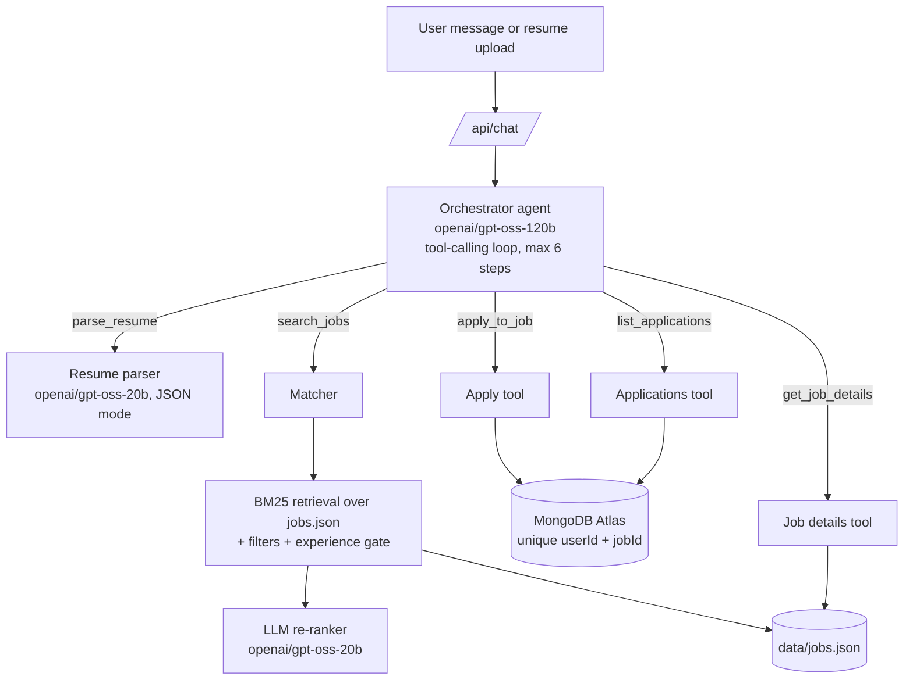

# Job Assistant

A conversational job-search assistant. Upload a resume (PDF or DOCX) in the chat, see the parsed details, get job recommendations with a match reason for each, refine them by chatting ("show only remote roles", "jobs needing React"), apply by chatting ("apply to job 3") and check your applications ("show my applied jobs").

**Live demo:** `<add your Vercel URL here>`
**Repository:** `<add your GitHub URL here>`

---

## Features

- Resume upload (PDF or DOCX) inside the chat, with automatic parsing into name, contact, designation, skills, experience, education and projects.
- Job recommendations from a dataset of 1,500+ real postings, each with a score and a short match reason.
- Natural-language refinement: remote only, skills, location, company, title keyword, maximum experience. Active filters appear as removable chips, and "Clear all" resets them.
- Apply by chat or with the Apply button. Applications are stored with job ID, applied date and status, and are never duplicated.
- Application status by chat ("show my applied jobs").
- Clear error handling for unreadable resumes, no matching jobs, invalid job references and duplicate applications.

## Tech stack

| Layer | Technology |
|---|---|
| Framework | Next.js 16 (App Router), JavaScript |
| UI | React, Tailwind CSS |
| LLM | Groq API (`groq-sdk`) with `openai/gpt-oss-120b` (agent) and `openai/gpt-oss-20b` (parsing and re-ranking) |
| Resume text extraction | `unpdf` (PDF), `mammoth` (DOCX) |
| Database | MongoDB Atlas (`mongodb` driver) |
| Job data | Greenhouse, Lever, Remotive and Arbeitnow public job APIs |
| Hosting | Vercel |

---

## Setup

### 1. Prerequisites

- Node.js 18 or newer (`node -v`)
- A free Groq API key: https://console.groq.com/keys
- A free MongoDB Atlas cluster: https://www.mongodb.com/atlas

### 2. Install

```bash
git clone <your-repo-url>
cd job-assistant
npm install
```

If you are building from scratch, the dependencies are:

```bash
npm i groq-sdk mongodb unpdf mammoth
```

### 3. Environment variables

Create `.env.local` in the project root:

```
GROQ_API_KEY=your_groq_key
MONGODB_URI=mongodb+srv://<db_user>:<db_password>@<cluster>.mongodb.net/?retryWrites=true&w=majority
```

Notes:

- Use the **database user** you created under Atlas "Database Access", not your Atlas login.
- URL-encode special characters in the password (`@` becomes `%40`).
- Under Atlas "Network Access", add `0.0.0.0/0` so Vercel can connect.
- Restart `npm run dev` after editing `.env.local`.

### 4. Build the jobs dataset

```bash
node scripts/fetchJobs.mjs
```

This collects postings from Greenhouse, Lever, Remotive and Arbeitnow, removes duplicates, keeps tech roles and writes `data/jobs.json` (target 1,500 to 2,000 jobs). If the report says fewer than 1,500, add more company names to `GREENHOUSE_BOARDS` or `LEVER_COMPANIES` in the script and run it again.

`data/jobs.json` must be committed to git so the deployed app has it.

Re-running the script reassigns job IDs, so clear the `applications` collection in Atlas afterwards.

### 5. Run locally

```bash
npm run dev
```

Open http://localhost:3000.

### 6. Deploy to Vercel

1. Push the repository to GitHub (with `data/jobs.json` committed).
2. Import the repository in Vercel.
3. Add the environment variables `GROQ_API_KEY` and `MONGODB_URI`.
4. Deploy, then test the full flow on the live URL: upload, refine, apply, apply again (duplicate), show applied jobs.

`next.config` includes `outputFileTracingIncludes: { "/api/**/*": ["./data/jobs.json"] }` so the dataset is bundled with the serverless functions.

---

## Project structure

```
app/
  layout.js                  Root layout
  page.js                    Renders the chat
  api/
    chat/route.js            Main endpoint: runs the orchestrator agent
    search/route.js          Direct re-search (used by filter chips)
    parse-resume/route.js    Standalone resume parsing endpoint
components/
  Chat.jsx                   Chat UI, profile card, job cards, filter chips, applications table
lib/
  agent.js                   Orchestrator agent and its tools
  resume.js                  Text extraction + resume parsing (LLM)
  matching.js                Retrieval (BM25) + LLM re-ranking
  db.js                      MongoDB: apply, list applications, unique index
  jobs.js                    Loads data/jobs.json
  groq.js                    Groq client, model names, rate-limit retry
scripts/
  fetchJobs.mjs              One-time dataset collection script
data/
  jobs.json                  Generated dataset
```

---

## Agent architecture

The assistant is an orchestrator agent that decides, on every message, which tool to call. Parsing, matching and applying are separate tools.



### Orchestrator (`lib/agent.js`)

- A Groq tool-calling loop. The model receives a system prompt with the candidate summary, the currently shown jobs (position to job ID) and the active filters.
- It calls tools, receives their results, and finishes with a short plain-text reply. The UI renders the profile card, job cards and applications table from the tool results, so the reply stays short.
- Tool arguments are validated server-side (null-safe parsing, job reference resolution).

### Tools

| Tool | Purpose | Arguments |
|---|---|---|
| `parse_resume` | Parse the uploaded resume into a structured profile | none (the file text is handled server-side) |
| `search_jobs` | Recommend or refine jobs | optional `remote`, `skills`, `location`, `titleKeyword`, `maxExperience`, `company` |
| `apply_to_job` | Apply and save the application | `position` (number in the shown list) or `jobId` |
| `list_applications` | Show applied jobs with date and status | none |
| `get_job_details` | Full details of one job | `position` or `jobId` |

### Sub-agents

1. **Resume parser** (`lib/resume.js`): extracts text with `unpdf` or `mammoth`, then asks the LLM (JSON mode) for name, email, phone, location, designation, years of experience, skills, target roles, education and projects.
2. **Matcher** (`lib/matching.js`), in two stages:
   - **Retrieval:** BM25 scores every job's title (weighted 3x) and description against a query built from the resume (designation, target roles, skills, projects). IDF weights come from the dataset itself, so common words count less. User filters are applied, and jobs whose minimum experience is far above the candidate's are removed.
   - **Re-ranking:** the top 20 candidates are sent to an LLM that excludes unrelated or too-senior roles, prefers postings where requested skills are central, and returns the best 8 with a score and a one-sentence reason. If the LLM call fails, the BM25 order is used.

### Guards

- A skill filter is kept only if the user actually named that skill, so the model cannot copy the whole resume into the filter.
- A maximum-experience filter is kept only if the user stated that number.
- If a resume was uploaded but the model did not call `parse_resume`, the server parses and searches anyway.
- Groq rate-limit errors (429) are retried automatically after the wait time Groq reports.

### Duplicate protection

MongoDB has a unique index on `(userId, jobId)`. A second apply to the same job raises a duplicate-key error, which `applyToJob` converts into `"duplicate"`. The agent then tells the user they already applied, and nothing new is saved. This also holds under concurrent requests.

---

## Data flow

### Resume upload

1. The user picks a file in the chat. The browser sends `multipart/form-data` to `POST /api/chat` with the `file` and a `payload` (messages, profile, user ID, shown jobs, filters).
2. The server validates the file (type, size at most 5 MB), extracts the text and checks that readable text was found.
3. The orchestrator calls `parse_resume`, then `search_jobs` with no filters.
4. The response contains the reply, the parsed profile, the job cards and the updated filters. The UI shows the profile card and the recommendations.

### Chat refinement

1. The user types "show only remote roles". The browser sends the last messages, the profile, the shown job IDs and the active filters to `POST /api/chat`.
2. The orchestrator calls `search_jobs` with the full set of filters that should apply, and the matcher returns new cards.
3. The UI shows the new cards and updates the filter chips.

### Apply

1. "Apply to job 3" (or the Apply button, which sends "Apply to job ID N") reaches the orchestrator.
2. `apply_to_job` resolves "job 3" to the third job in the displayed list, checks that it exists, and inserts a document into MongoDB.
3. The tool returns success or duplicate, and the reply tells the user.

### Application status

`list_applications` reads the user's documents from MongoDB, joins them with job titles and companies from the dataset, and the UI renders a table (job ID, role, applied date, status).

### Filter chips

Removing a chip or pressing "Clear all" calls `POST /api/search` directly with the new filter set. This is a UI shortcut that skips the agent.

### Client state

The browser keeps the messages, the parsed profile, the IDs of the jobs on screen and the active filters. The server is stateless. The user ID is a random UUID stored in `localStorage`.

---

## APIs

### Internal endpoints

#### `POST /api/chat`

Main endpoint. Two request formats:

**JSON** (normal messages):

```json
{
  "messages": [{ "role": "user", "content": "show only remote roles" }],
  "profile": { "...": "parsed profile or null" },
  "userId": "uuid",
  "shownJobIds": [412, 87, 1203],
  "filters": { "remote": true }
}
```

**multipart/form-data** (resume upload): fields `file` (PDF or DOCX) and `payload` (the JSON above as a string).

Response:

```json
{
  "reply": "Here are remote roles that match your profile.",
  "profile": null,
  "jobs": [
    {
      "position": 1, "id": 412, "title": "...", "company": "...", "location": "...",
      "remote": true, "experience": "0-2 years", "skills": ["React"],
      "sourceUrl": "https://...", "score": 86, "reason": "..."
    }
  ],
  "applications": null,
  "shownJobIds": [412],
  "filters": { "remote": true }
}
```

`profile` is set only when a resume was parsed in this request. `jobs` and `applications` are `null` unless a tool produced them.

Errors return `{ "error": "message" }` with status 400, 413, 422, 429, 500 or 502.

#### `POST /api/search`

Direct search used by the filter chips.

Request: `{ "profile": {...}, "filters": {...} }`
Response: `{ "jobs": [...], "total": 12, "hiddenByExperience": 3, "shownJobIds": [...] }`

#### `POST /api/parse-resume`

Standalone resume parsing. The UI no longer uses it (upload goes through `/api/chat` and the `parse_resume` tool), but it works on its own.

Request: `multipart/form-data` with `file`.
Response: `{ "profile": {...} }`

### External services

| Service | Used for |
|---|---|
| Groq chat completions | Orchestrator (`openai/gpt-oss-120b`), resume parsing and re-ranking (`openai/gpt-oss-20b`), JSON mode and tool calling |
| Greenhouse Job Board API (`boards-api.greenhouse.io`) | Job dataset |
| Lever Postings API (`api.lever.co`) | Job dataset |
| Remotive API (`remotive.com/api`) | Job dataset |
| Arbeitnow API (`arbeitnow.com/api`) | Job dataset |
| MongoDB Atlas | Application storage |

### Data models

**Application** (collection `applications` in database `jobassist`):

```json
{ "userId": "uuid", "jobId": 412, "appliedAt": "2026-10-31T10:15:00.000Z", "status": "Applied" }
```

Unique index on `{ userId, jobId }`.

**Job** (`data/jobs.json`): `id`, `title`, `company`, `location`, `remote`, `experience`, `experienceMin`, `skills`, `description`, `sourceUrl`, `source`.

---

## Error handling

| Situation | Behavior |
|---|---|
| Unsupported file type | "Unsupported file type. Please upload a PDF or DOCX resume." |
| File over 5 MB | "That file is over 5 MB. Please upload a smaller resume." |
| Corrupted or password-protected file | "I couldn't read that file..." |
| Scanned PDF with no text | "I couldn't find readable text in this resume..." |
| File is not a resume | The `parse_resume` tool returns an error and the assistant asks for a resume |
| No jobs match the filters | The assistant lists the filters applied and offers to relax one; if the cause is experience, it says so and offers a higher limit |
| Invalid job reference | "There is no job at position N" or "Job ID N does not exist" |
| Missing job reference | Asks which job (list number or job ID) |
| Apply before uploading a resume | Asks the user to upload a resume first |
| Duplicate application | "You already applied to ..." and nothing is saved |
| Groq rate limit | Automatic retry, then a clear message |
| Missing API key, dataset or database | Specific error message in the chat |

## Limitations

- The user is identified by a random ID in `localStorage`. Clearing site data creates a new user. A production version would add authentication.
- The free Groq tier limits tokens per minute, so a resume upload can take several seconds.
- Recommendation quality depends on the dataset. Add more company boards in `scripts/fetchJobs.mjs` for more junior and niche roles.
- Replies are not streamed, and the conversation is not persisted across page reloads.
- "Apply" records the application in the database. It does not submit anything to the employer's site.

## Example conversation

1. Upload `resume.pdf`. The assistant shows the extracted details and the top matches.
2. "Show only remote roles." Remote matches appear and a "Remote only" chip is added.
3. "Jobs needing React." The skill chip is added and only React-centered roles remain.
4. "Remove the remote filter." The chip is removed and the list refreshes.
5. "Apply to job 2." The application is saved.
6. "Apply to job 2." The assistant says you already applied.
7. "Apply to job 99." The assistant says that job is not in the list.
8. "Show my applied jobs." A table of applications appears.
